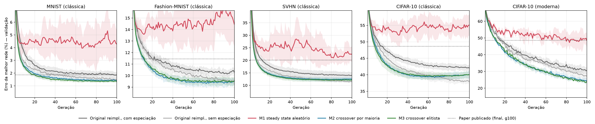
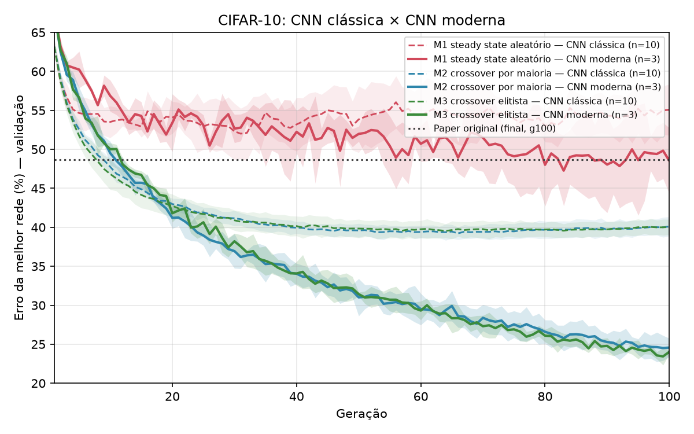

# Experimentos: neuroevolução epigenética de CNNs

Este diretório reimplementa o método de Hadjiivanov & Blair (2021), *Epigenetic evolution of deep convolutional models* ([arXiv:2104.05411](https://arxiv.org/abs/2104.05411)), e vai **além do paper** em duas direções:

1. **Outras estratégias de reprodução**: três alternativas ao crossover original, comparadas no mesmo framework.
2. **Uma CNN moderna**: as mesmas regras de evolução aplicadas a redes com BatchNorm, atalhos residuais e data augmentation.

## A ideia em 30 segundos

Uma população de CNNs evolui ao longo de gerações. Cada rede é um **genoma**: uma lista de camadas convolucionais e densas em que **cada kernel tem seu próprio formato** (`h × w`, ímpares de 1 a 7). A evolução muda a arquitetura: adiciona e remove kernels, camadas e neurônios, redimensiona kernels e muda o stride.

O ponto central é a **herança epigenética**: o filho não começa do zero. Ele herda os **pesos já treinados** dos pais e continua treinando a partir deles. A cada geração:

1. todas as redes treinam **1 época em 10% aleatórios** do treino ("aprendizado em vida");
2. a fitness é a **acurácia de validação** (5 000 imagens separadas do treino, split fixo);
3. nascem 12 filhos (população de 24), por crossover e mutação, que substituem outros indivíduos.

## O que comparamos

Os cinco métodos usam o mesmo genoma, as mesmas mutações, o mesmo treino e o mesmo número de filhos por geração. **Só muda a forma de reproduzir e selecionar.**

| Método (`--method`) | Como reproduz |
|---|---|
| `paper_spec` | **Original** (Seções II-B e III do paper): especiação por estrutura, seleção proporcional ao fitness relativo, crossover nó a nó ponderado pelo fitness, culling por idade e fitness. |
| `paper_nospec` | Original **sem especiação** (o paper também reporta esta variante). |
| `steady_random` (M1) | *Steady state* aleatório: 2 pais sorteados, crossover uniforme (p=0,5), o filho substitui um indivíduo qualquer. Sem elitismo. É a linha de base "ingênua". |
| `majority` (M2) | **Crossover por maioria** com 3 pais (torneio): cada gene estrutural recebe o valor majoritário ou mediano; os pesos vêm do pai mais apto da maioria. Filhos substituem os piores. |
| `elitist` (M3) | **Crossover elitista**: um pai é sempre o campeão e o outro vem de torneio; o crossover é uniforme com viés de 0,7 para o campeão. O campeão nunca é removido. |

### CNN clássica × moderna (`--arch`)

- **`classic`**: conv → ReLU, redes iniciais pequenas (1–2 camadas, 4–12 kernels), Adam. É o cenário do paper.
- **`modern`**: conv → **BatchNorm** → (+ **atalho residual**) → ReLU, **global average pooling**, redes iniciais maiores (3–5 camadas, 32–96 kernels), AdamW, bf16 e, com `--augment`, recorte aleatório + espelhamento. A evolução é idêntica; a pergunta é se ela continua útil quando a rede base é melhor.

## Resultados

Acurácia de **teste** do campeão final (escolhido pela validação), média ± desvio-padrão entre sementes. Tabelas completas e testes estatísticos estão em [`analysis/comparacao_reimpl.md`](analysis/comparacao_reimpl.md) e [`analysis/resultados.md`](analysis/resultados.md).

**CNN clássica, 10 sementes, 100 gerações**

| Método | MNIST | Fashion-MNIST | SVHN | CIFAR-10 |
|---|---|---|---|---|
| Paper publicado (Tabela I, c/ esp.) | 98,13 ± 0,15 | 88,54 ± 0,70 | 79,86 ± 2,06 | 51,35 ± 3,44 |
| Original reimpl., c/ especiação | 98,21 ± 0,29 | 89,65 ± 0,34 | 83,32 ± 1,20 | 57,34 ± 1,13 |
| Original reimpl., s/ especiação | **98,56 ± 0,17** | **90,26 ± 0,21** | **86,80 ± 0,80** | **61,58 ± 0,45** |
| M1 steady state aleatório | 96,11 ± 1,09 | 84,99 ± 1,92 | 75,39 ± 3,37 | 45,59 ± 3,18 |
| M2 crossover por maioria | 98,46 ± 0,11 | 90,05 ± 0,30 | 84,93 ± 1,07 | 58,62 ± 1,09 |
| M3 crossover elitista | 98,53 ± 0,16 | 89,90 ± 0,29 | 85,29 ± 0,99 | 58,61 ± 0,93 |

**CNN moderna, CIFAR-10, 3 sementes (parcial; a rodada com 10 sementes está em andamento)**

| Método | CIFAR-10 |
|---|---|
| Original reimpl., c/ especiação | 68,60 ± 1,66 |
| Original reimpl., s/ especiação | 71,76 ± 1,61 |
| M1 steady state aleatório | 51,55 ± 4,27 |
| M2 crossover por maioria | 74,45 ± 1,22 |
| M3 crossover elitista | **75,20 ± 0,32** |



### O que tiramos disso

- **A reimplementação reproduz o paper e o supera um pouco.** A versão com especiação fica igual ou acima da Tabela I em todos os datasets. Atenção: o paper seleciona a melhor rede pelo *teste*; aqui a seleção é pela *validação*, o que é mais conservador.
- **Herança sem seleção não funciona.** M1 é o pior em todos os cenários: seus filhos nascem com ~12–18% de acurácia antes do treino (contra ~43–76% em M2/M3), ou seja, os pesos herdados quase não servem. Isso mostra que o ganho vem da combinação entre herança epigenética e pressão seletiva, não da herança sozinha.
- **Maioria e elitismo empatam entre si** (Mann-Whitney, p > 0,3 em todos os datasets) e ficam no nível do método original. Na CNN clássica, o original **sem** especiação é o melhor (+1,5 a 3 pp sobre M2/M3 no SVHN e no CIFAR-10), mas produz redes bem maiores (710–840k parâmetros contra 130–310k).
- **Com a CNN moderna o quadro muda.** No CIFAR-10, a acurácia sobe de ~58% para ~75%, e M2/M3 passam à frente do original. Com só 3 sementes, porém, as diferenças ainda não são significativas (p Holm = 0,6), e por isso estamos completando 10 sementes.



## Arquivos

| Arquivo | Para que serve |
|---|---|
| `neuroevo.py` | Tudo: dados, genoma, fenótipo (PyTorch), mutações, os 5 métodos e o loop evolutivo. Gera um JSON por execução. |
| `run_all.sh` | Grade M1–M3 × 4 datasets × 10 sementes, CNN clássica (usa todas as GPUs). |
| `run_paper.sh` | Método original (c/ e s/ especiação): clássica nos 4 datasets e moderna no CIFAR-10. |
| `run_modern.sh` / `run_modern10.sh` | CNN moderna no CIFAR-10: teste rápido (3 sementes) e rodada completa (5 métodos × 10 sementes). |
| `analyze.py` | Tabela M1–M3 + teste de Mann-Whitney → `analysis/resultados.md`. |
| `compare_reimpl.py` | Original reimpl. × M1–M3, com correção de Holm → `analysis/comparacao_reimpl.md` + curva de erro. |
| `plot_erro.py`, `plot_curva_erro.py`, `plot_modern.py` | Figuras em `analysis/`. |
| `partial.py`, `partial_modern.py` | Resumo de execuções ainda em andamento. |
| `results/`, `results_modern/` | Um JSON por execução: config, métricas por geração e resultado final. |

## Como rodar

Requisitos: Python 3, PyTorch + torchvision (com CUDA), numpy, scipy e matplotlib. Os scripts esperam um venv em `experimentos/.venv`; os datasets são baixados em `~/data`.

```bash
cd experimentos
python -m venv .venv && .venv/bin/pip install torch torchvision numpy scipy matplotlib

# uma execução
.venv/bin/python neuroevo.py --dataset cifar10 --method majority --seed 0 --gens 100
.venv/bin/python neuroevo.py --dataset cifar10 --method elitist --seed 0 --arch modern --augment --out results_modern

# grades completas (pulam o que já terminou, dá para retomar)
SEEDS=10 JOBS=16 ./run_all.sh
GPU=0 JOBS=18 ./run_modern10.sh

# análise
python compare_reimpl.py
python analyze.py results analysis
```

Em servidor compartilhado, `--mem_frac` limita a fração da memória da GPU usada por processo.
